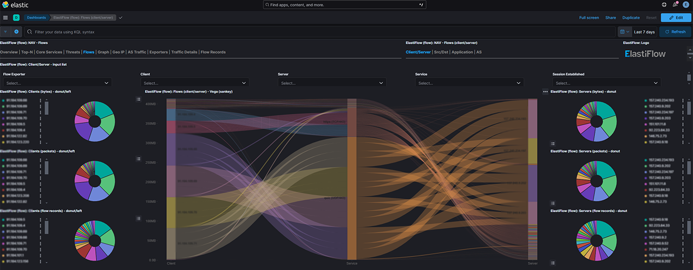
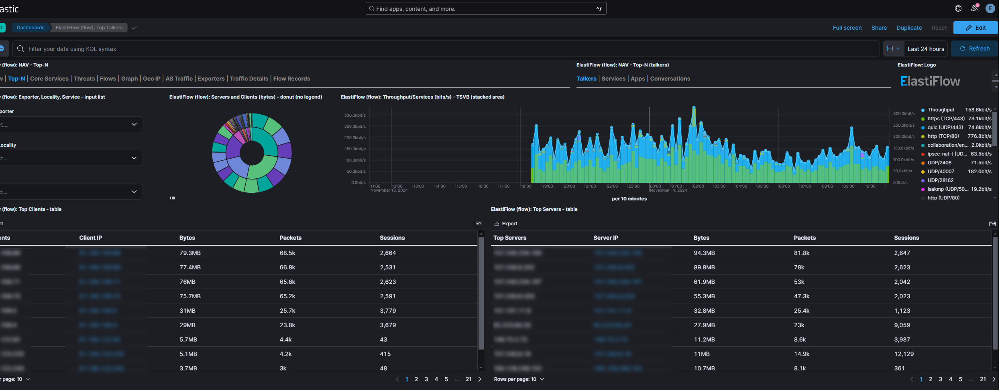

# NetFlow Collector Installation
The NetFlow Collector is built on the Elastic Stack: Elasticsearch, Kibana, and the ElastiFlow Flow Collector, all running as Docker containers on a single node.

## Requirements
It's important to keep in mind that in production environments, the volume of data generated by multiple network flow sources can be substantial. Core routers or firewalls can generate thousands of flow records per second, which is not uncommon.

In my experience, many people underestimate the amount of flow data their networks will produce. To avoid potential issues, it's wise not to start with too small a setup. Use the following table as a guide to ensure you're adequately prepared:

flows/sec | (v)CPUs | Memory | Disk (30-days) | ES JVM Heap
---:|---:|---:|---:|---:
250 | 4 | 32 GB | 512 GB | 12 GB
500 | 6 | 48 GB | 1 TB | 16 GB
1000 | 8 | 64 GB | 2 TB | 24 GB
1500 | 12 | 96 GB | 3 TB | 31 GB

Keep the ES heap at no more than ~50% of RAM (and below 31 GB; e.g. 11g on a 23 GB host); the rest is used as page cache by Lucene.
The ElastiFlow collector (7.x) is a Go binary, so it needs no JVM heap.

Software: a recent Linux, Docker with the Compose plugin (`docker compose`), `openssl`.

Versions: Elasticsearch / Kibana **9.5.5** (official `docker.elastic.co` images), ElastiFlow flow collector **7.27.3**, dashboards `kibana-9.5.x-flow-ecs.ndjson` (from [elastiflow_for_elasticsearch](https://github.com/elastiflow/elastiflow_for_elasticsearch)).
Without a license key the collector runs in ElastiFlow's Community tier, limited to **500 flow records/sec** — the larger rows of the table above need an ElastiFlow license.

Prebuilt copies of the same images (amd64) are also on Docker Hub: `lsopromadze/netflow-elasticsearch:9.5.5`, `lsopromadze/netflow-kibana:9.5.5`, `lsopromadze/netflow-flowcollector:7.27.3` (also tagged `latest`). The older 8.16 images are tagged `old`.

## 1. Host preparation
Put the data on the big disk (adjust the path, and the volume in `docker-compose.yml`, if yours differs):
```bash
mkdir -p /opt/netflow_es
chown 1000:1000 /opt/netflow_es
```

Kernel settings (`/etc/sysctl.d/90-netflow.conf`), then `sysctl --system`:
```
vm.max_map_count = 1048576
vm.swappiness = 1
net.core.rmem_max = 33554432
net.core.rmem_default = 33554432
net.core.netdev_max_backlog = 4096
```

Docker log rotation (`/etc/docker/daemon.json`), then `systemctl restart docker`:
```json
{ "log-driver": "json-file", "log-opts": { "max-size": "50m", "max-file": "3" } }
```

## 2. Certificates (Elasticsearch transport TLS)
```bash
cd ssl
./generate_certs.sh            # valid for 10 years; edit -subj if you like
chmod 600 *.key
chown -R 1000:1000 .
cd ..
```

## 3. Secrets
Passwords and keys are read from `.env` (never commit it):
```bash
umask 077
cat > .env <<EOF
ELASTIC_PASSWORD=$(openssl rand -hex 16)
KIBANA_SYSTEM_PASSWORD=$(openssl rand -hex 16)
COLLECTOR_PASSWORD=$(openssl rand -hex 16)
KIBANA_ENCRYPTION_KEY=$(openssl rand -hex 32)
EOF
```
`ELASTIC_PASSWORD` becomes the `elastic` superuser password on first start.

## 4. Start Elasticsearch and create users
```bash
docker compose up -d es_master1
set -a; . ./.env; set +a
E="curl -s -u elastic:$ELASTIC_PASSWORD -H Content-Type:application/json http://127.0.0.1:9200"

# Kibana's service account
$E/_security/user/kibana_system/_password -d "{\"password\":\"$KIBANA_SYSTEM_PASSWORD\"}"

# Least-privilege user for the collector
$E/_security/role/elastiflow_writer -XPUT -d '{"cluster":["monitor","manage_index_templates","manage_ilm","manage_pipeline"],"indices":[{"names":["elastiflow-*"],"privileges":["create_index","create_doc","index","write","manage","view_index_metadata","auto_configure"]}]}'
$E/_security/user/elastiflow_writer -XPUT -d "{\"password\":\"$COLLECTOR_PASSWORD\",\"roles\":[\"elastiflow_writer\"]}"

# Retention: daily rollover, delete after 30 days
$E/_ilm/policy/elastiflow -XPUT -d '{"policy":{"phases":{"hot":{"actions":{"rollover":{"max_primary_shard_size":"30gb","max_age":"1d"},"set_priority":{"priority":100}}},"warm":{"min_age":"2d","actions":{"forcemerge":{"max_num_segments":1},"set_priority":{"priority":50}}},"delete":{"min_age":"30d","actions":{"delete":{}}}}}}'
```
To change a password later: `docker exec -it netflow-elastic bin/elasticsearch-reset-password -u <user>`, then update `.env` and `docker compose up -d`.

## 5. Start everything
```bash
docker compose up -d
```
All containers use `restart: unless-stopped`, so they come back after a reboot as long as Docker is enabled (`systemctl enable docker`). No extra systemd unit is needed.

Elasticsearch listens on `127.0.0.1` only; Kibana is on port **5601**.

## 6. Import Kibana dashboards
Stack Management → Kibana → Saved Objects → Import → `kibana-9.5.x-flow-ecs.ndjson`, or:
```bash
curl -u elastic:$ELASTIC_PASSWORD -H kbn-xsrf:true -X POST \
  "http://127.0.0.1:5601/api/saved_objects/_import?overwrite=true" \
  --form file=@kibana-9.5.x-flow-ecs.ndjson
```

## 7. Kibana settings (optional)
Open the ElastiFlow Overview dashboard on login, use flows as the default data view, and set a fixed time zone (change `Asia/Tbilisi` to yours).
Kibana 9.x only exposes this endpoint internally, hence the extra header:
```bash
curl -u elastic:$ELASTIC_PASSWORD -H kbn-xsrf:true -H x-elastic-internal-origin:kibana \
  -H Content-Type:application/json -X POST http://127.0.0.1:5601/internal/kibana/settings -d '{"changes":{
  "defaultRoute":"/app/dashboards#/view/b1e9f8e3-e0c9-4d88-9b9b-5f8d3c6c6d28",
  "defaultIndex":"elastiflow-flow-ecs-*",
  "dateFormat:tz":"Asia/Tbilisi",
  "timepicker:timeDefaults":"{\"from\":\"now-1h\",\"to\":\"now\"}",
  "home:welcome:show":false,
  "hideAnnouncements":true}}'
```
(`b1e9f8e3-…` is the ID of "ElastiFlow (flow): Overview" in `kibana-9.5.x-flow-ecs.ndjson`.)

## Check that flows are arriving
Flows per exporter (`host.ip` is the device that sent the flow):
```bash
curl -s -u elastic:$ELASTIC_PASSWORD -H Content-Type:application/json \
  "http://127.0.0.1:9200/elastiflow-flow-ecs-*/_search?size=0" \
  -d '{"query":{"range":{"@timestamp":{"gte":"now-5m"}}},"aggs":{"exporters":{"terms":{"field":"host.ip"}}}}'
```
Divide the counts by 300 for flows/sec. In Kibana, see the "ElastiFlow (flow): Flow Exporters" and "ElastiFlow (metrics): Collector" dashboards.

## Collector port
The collector listens on **UDP 2055** (NetFlow v5/v9, IPFIX).

Do **not** use UDP 5678: MikroTik routers broadcast their neighbor discovery (MNDP) on that port, which floods the collector with undecodable packets.

## Firewall (firewalld)
```bash
F="firewall-cmd --permanent --zone=public"
for net in 10.0.0.0/8 172.16.0.0/12 192.168.0.0/16; do
  $F --add-rich-rule="rule family=ipv4 source address=$net port port=5601 protocol=tcp accept"
  $F --add-rich-rule="rule family=ipv4 source address=$net port port=2055 protocol=udp accept"
done
firewall-cmd --reload
```
Narrow the source ranges to your admin network and your exporters.

## GeoIP / ASN databases (DB-IP Lite)
GeoIP and ASN enrichment uses the free **DB-IP Lite** databases (no account or license key needed).
They are saved under the GeoLite2 file names the collector is configured to read, in `elastiflow/maxmind/`.
The `.mmdb` files are not stored in git (the city database is >100 MB); download them before the first start:
```bash
install -m 755 geoip/netflow-geoip-update /usr/local/sbin/
cp geoip/netflow-geoip-update.service geoip/netflow-geoip-update.timer /etc/systemd/system/
systemctl daemon-reload
systemctl enable --now netflow-geoip-update.timer   # monthly, on the 3rd
/usr/local/sbin/netflow-geoip-update                # first download now
```
The script keeps the previous files as `*.mmdb.prev` and restarts the collector only when the data changed.
(Edit `DIR=` in the script if the repo is not in `/opt/netflowcollector-elk`.)

IP Geolocation by DB-IP (https://db-ip.com), licensed under CC BY 4.0.

## Screens



## Network device configuration
MikroTik (RouterOS 7):
```
/ip traffic-flow set enabled=yes interfaces=all active-flow-timeout=1m inactive-flow-timeout=15s
/ip traffic-flow target add dst-address=<collector-ip> port=2055 version=9
```

Cisco IOS-XE: if you're interested in learning how to configure a network device to send NetFlow data, I recommend checking out this insightful article by my friend. He played a crucial role in helping me with assembly and testing.
https://ccie37726.blogspot.com/2022/02/howto-flexible-netflow-with-ios-xe.html
